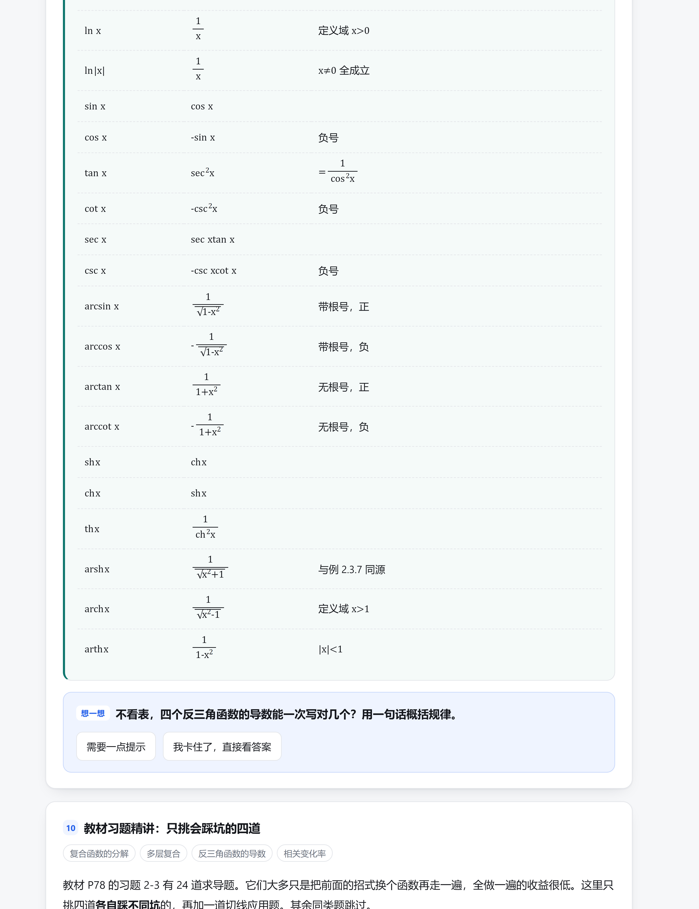

# 知识破壁机 · dsh-break-knowledge

[](https://github.com/StevenX-YT/dsh-break-knowledge/actions/workflows/test.yml)

把课本拍成照片，变成一份**能讲解、能出题、能判分、能查缺补漏**的单文件学习页。

输出是一个 HTML 文件：双击就开，可以发微信、塞进手机、离线用。没有任何后端、没有任何外部依赖。

---

## 它解决什么

看教材的时候，最难的不是「不知道答案」，而是：

- 定理看懂了，但不知道为什么要有那个条件
- 证明每一步都认识，连起来不知道在干嘛
- 例题看懂了解法，换个函数就不会
- 做错了题，不知道是概念错还是算错

这三件事教材都不管，老师也未必讲。这个项目把教材拆成**可交互的学习页**：每个知识点配三级提示的引导提问，每个公式逐项拆解，每道例题每步都标「这一步为什么能这么做」。



## 效果

| 桌面 | 手机 |
|---|---|
|  |  |

- **讲解**：定理 / 公式 / 证明 / 例题 / 易错，六类内容块各自带分层解释
- **检验**：7 种题型（单选、判断、填空、数值、分步、找错、简答），即时判分
- **报告**：知识点掌握度、待补漏清单、错因归类

## 快速开始

```bash
# 渲染一份学习页
node engine/render.mjs samples/gaoshu-p73-78.json out/lesson.html

# 多章合并成一本（一个文件装整本，适合发手机）
node engine/render.mjs samples/book.example.json out/book.html
```

产物是单文件 HTML，直接打开即可。

### 在 DSH 里用

本项目同时是一个 DeepSeek Harness 插件。把 `plugin/study-html` 作为本地 bundle 安装（在 DSH 对话里让 Agent 执行 `plugin_manager install_bundle`，target 填该目录的绝对路径）即可。

装好后：

- 侧栏多一个「学习页」图标，列出已生成的页面，点「打开」用系统浏览器打开
- 对话里可以直接调 `study_render` 工具，Agent 生成内容后一条命令出页

## 内容怎么写

渲染器只认 JSON。结构见 `samples/` 下的两个样例，骨架见 `skeleton/`：

| 文件 | 用途 |
|---|---|
| `skeleton/theorem-track.json` | 定理型（数理化）：动机 → 定理 → 证明 → 例题 → 公式表 |
| `skeleton/concept-track.json` | 概念型（文/法/经管）：引例 → 定义 → 判据 → 例题 → 易错 |
| `skeleton/why-guide.md` | 每一步的 `why` 该怎么写（好例 / 差例对照） |

### 三条硬规则

这些不是风格偏好，是踩过坑写下来的：

1. **`why` 必须有信息量。**「这是后面所有式子的起点」「显然」「证毕」一律算失败。合格的 why 回答三者之一：这步在做什么 / 为什么必须这么做 / 不做会怎样。
2. **公式要拆项。** 定理和公式下用 `terms` 逐个说明每个符号是什么量的什么率、回答什么问题。
3. **图只画「盒子 + 箭头」。** 需要精确曲线坐标的图（函数图像、几何对称），手写 SVG 必然失真，宁可不画。

`engine/render.mjs` 会在渲染时自动体检这三条：why 太短、命中套话、基本是 op 的同义重复、`terms` 为空、`figure` 缺 svg —— 都会列出来。

## 架构

```
图片 ──(Agent 读图 + OCR)──> content.json ──(render.mjs)──> 单文件 HTML
                                                    │
                                          app.css / app.js / grade.js / math.js
```

| 文件 | 职责 |
|---|---|
| `engine/render.mjs` | 校验、体检、组装、写出 |
| `engine/app.js` | 讲解 / 检验 / 报告的视图与状态机 |
| `engine/grade.js` | 判分与掌握度（浏览器与 Node 共用） |
| `engine/math.js` | 迷你公式渲染器（`\frac \sqrt ^{} _{} \varphi \Delta \lim`），不引 KaTeX |
| `engine/app.css` | 主题变量、深浅色、手机断点、打印样式 |
| `plugin/study-html/` | DSH 插件（Host 工具 + 侧栏面板） |

## 开发

```bash
# 判分内核单测
node engine/test-grade.mjs

# 端到端（无头浏览器真实点击一遍）
node engine/test-browser.mjs out/lesson.html
```

端到端测试是数据驱动的：断言的题目 id、选项索引都从页面内嵌的内容里读，换任何内容都能跑。

## 已知限制

- **摄取仍是半自动**：图片 → `content.json` 这一步由 Agent 完成，没有独立的 OCR 管线。复杂公式（多层根号、分式套分式）需要人工核对。
- **只做 HTML 能判分的题型**：手写过程、拍照作答、语音作答都不支持——这是 HTML 的边界，不是偷懒。
- **进度存在浏览器**：`file://` 与 `http://` 不同源各存一份；iOS Safari 可能禁用 `file://` 下的 localStorage，页面底部提供「导出 / 导入进度」兜底。

## 许可

MIT
